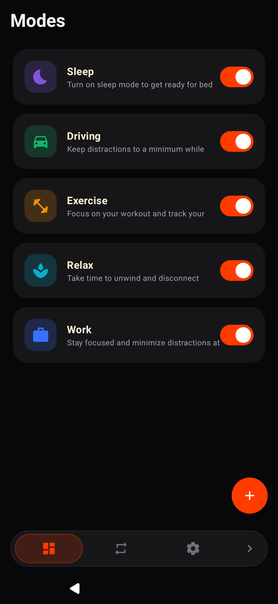
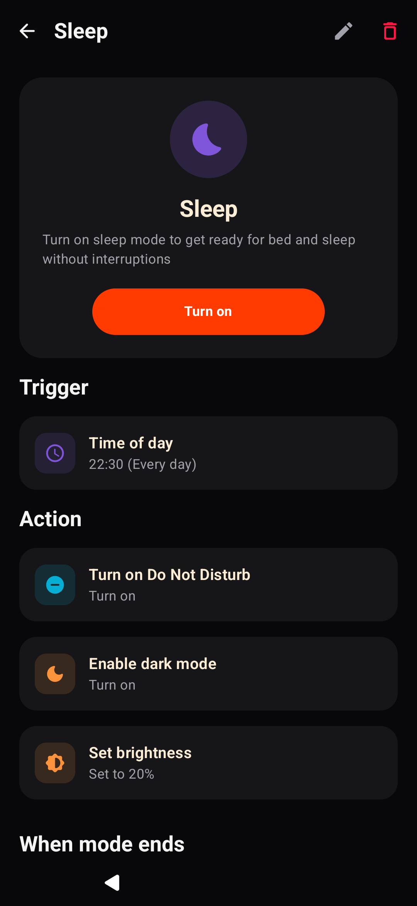
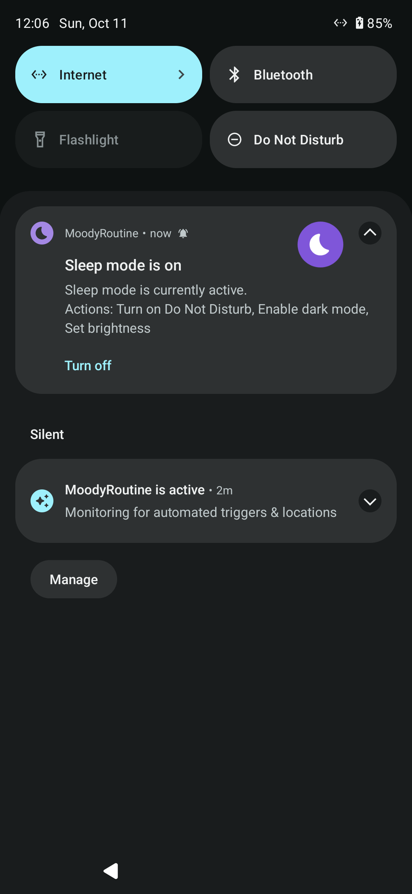
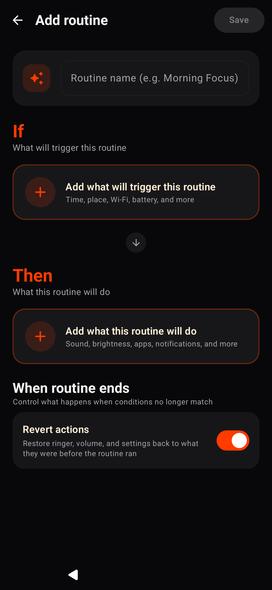

# MoodyRoutine

Samsung One UI-style Modes and Routines automation engine for Android devices.

MoodyRoutine brings contextual automation, situational profiles, and event-driven workflows to any Android device running Android 8.0 (API 26) or higher. It reproduces the design philosophy, ergonomics, and automation capabilities of Samsung's One UI Modes & Routines without requiring root privileges or manufacturer-locked frameworks.

---

## Overview

MoodyRoutine operates on two primary automation abstractions:

* **Modes**: Persistent, state-based profiles representing real-world situations (e.g., Sleep, Work, Driving, Exercise, Relax). Modes bundle multiple device settings together, run an ongoing background service, and provide persistent status bar controls with icon synchronization.
* **Routines**: Event-driven automation rules following an `IF (Conditions) -> THEN (Actions)` architecture. When conditions become true, actions execute sequentially, and prior states can be automatically restored when conditions cease to match.

---

## Screenshots

<p align="center">
  
  
  
  
</p>

---

## Features

### Modes

Modes allow bundling device settings into situational profiles:

* **Sleep Mode**: Enables Do Not Disturb, reduces screen brightness, activates dark mode, and silences notifications.
* **Work Mode**: Switches ringer to vibrate, mutes media, and restricts distracting applications.
* **Driving Mode**: Enables auto-rotate, adjusts media volume, and launches navigation.
* **Exercise Mode**: Configures media volume and launches workout tracking.
* **Relax Mode**: Reduces screen brightness, silences alerts, and starts music or ambient audio.
* **Custom Modes**: Users can define arbitrary modes with custom naming, color schemes, and 30+ categorized icons.
* **Stay Focused (App Blocker)**: Restricts selected applications while a mode is active. If a restricted app is launched, an overlay appears with options to close the app, snooze for 5 minutes, or turn off the mode.
* **State Reversion**: Automatically snapshots prior volume, ringer, and display settings before mode activation, restoring them upon deactivation.
* **Status Bar Notifications**: Ongoing foreground notification displaying the active mode name and icon with an instant "Turn off" action.

### Routines

Routines automate actions based on environmental triggers:

#### Conditions (IF)
* **Schedule**: Exact time of day, time ranges, and day-of-week recurrence.
* **Location**: Geofencing with radius configuration via an interactive OpenStreetMap picker (arrive and leave events).
* **Battery and Power**: Battery percentage thresholds (above or below), charging connected, and power disconnected.
* **Network and Connectivity**: Wi-Fi connected/disconnected (with specific SSID targeting), Bluetooth connected/disconnected (with paired device selection).
* **Applications**: Application opened or closed (detected via UsageStats monitoring).
* **Hardware**: Wired or Bluetooth headphones connected/disconnected.

#### Actions (THEN)
* **Sound and Vibration**:
  * Volume control: Ring, media, alarm, and notification sliders (0-100%).
  * Ringer modes: Normal, vibrate, and silent.
  * Do Not Disturb: On, off, priority only, and alarms only.
* **Display**:
  * Screen brightness adjustment (0-100%).
  * Auto-rotate toggle (enable/disable).
  * Dark mode toggle (enable/disable).
  * Home screen wallpaper: Apply selected images using Android `FLAG_SYSTEM`.
  * Lock screen wallpaper: Apply selected images using Android `FLAG_LOCK`.
* **Apps and Shortcuts**:
  * Application launcher: Open any installed application.
  * Static shortcuts: Auto-detected shortcuts declared in application manifests (e.g., Chrome Incognito, Camera modes, YouTube subscriptions).
  * Interactive shortcut creators: Support for third-party shortcut configurations (e.g., direct chats, navigation routes, speed dials).
  * Standard deep actions: Built-in media actions (play/resume, radio, browse, library) for streaming services such as Apple Music, YouTube Music, and Spotify.
* **Flow Control**:
  * Wait / Delay: Pause execution between sequential actions (configurable from 1 second to 120 seconds with quick presets).
* **Device and Notifications**:
  * Flashlight toggle (on/off).
  * Custom notifications with configurable title and message body.

---

## Design and User Experience

* **One UI Ergonomics**: Designed around large viewing areas at the top and actionable elements within thumb reach at the bottom.
* **Card Architecture**: Rounded containers (`18dp` to `24dp` corners) with subtle tonal elevations and dark theme support.
* **Color and Icon System**: Consistent category-specific color coding and vector iconography across triggers, actions, and mode states.
* **Location Picker**: Integrated OpenStreetMap interface with Nominatim address search, live coordinate display, radius circle rendering, and pan/zoom controls.

---

## Architecture and Tech Stack

* **Platform**: Android 8.0+ (API 26 to 35)
* **Language**: Kotlin 2.0+
* **UI Framework**: Jetpack Compose with Material 3
* **Concurrency**: Kotlin Coroutines and StateFlow
* **Database**: Room persistence library with type converters
* **Dependency Injection / State**: Jetpack ViewModel and Lifecycle Service
* **Location**: Google Play Services Location Provider + OsmDroid
* **Background Processing**: Foreground Service with `specialUse` subtype, BroadcastReceivers, and exact AlarmManager scheduling

---

## Installation

### Get MoodyRoutine

| Method | Source / Action |
|---|---|
| **GitHub Releases** | [Download APK](https://github.com/naman-chopra/moody-routine/releases) |
| **Obtainium** | [](https://apps.obtainium.imranr.dev/redirect.html?r=obtainium://add/https://github.com/naman-chopra/moody-routine) |
| **F-Droid** | *In review* ([MR !52105](https://gitlab.com/fdroid/fdroiddata/-/merge_requests/52105)) |

1. Download the APK (or use the one-click **Add to Obtainium** badge above).
2. Open the file and allow installation from unknown sources if prompted.
3. Grant required runtime permissions on first launch.

### Verification (AppVerifier / Checksum)

To ensure the integrity and authenticity of the downloaded APK, you can verify the signing certificate using [AppVerifier](https://github.com/soupslurpr/AppVerifier) or `apksigner`:

* **Package Name:** `com.ndev.moodyroutine`
* **Signing Key SHA-256 Fingerprint:**
  ```text
  E1:22:92:3E:45:9F:D6:ED:0A:DD:A5:1A:53:0B:BE:61:DF:8D:66:F8:E8:28:AA:B8:7A:82:07:AD:B6:61:E9:CB
  ```
* **Signing Key SHA-1 Fingerprint:**
  ```text
  74:E0:8B:EA:24:C8:71:3C:E8:31:D1:0A:F0:B7:7E:7D:32:33:71:99
  ```

### Building from Source

Prerequisites:
* Android SDK (API 35 compileSdk)
* JDK 17

```bash
# Clone the repository
git clone https://github.com/naman-chopra/moody-routine.git
cd moody-routine

# Build FOSS release APK (100% libre / de-Googled, native AOSP LocationManager)
./gradlew assembleFossRelease

# Build GMS release APK (Google Play Services location provider)
./gradlew assembleGmsRelease
```

Generated APK paths:
* FOSS Release: `app/build/outputs/apk/foss/release/app-foss-release.apk`
* GMS Release: `app/build/outputs/apk/gms/release/app-gms-release.apk`

---

## Permissions Overview

| Permission | Category | Purpose |
|---|---|---|
| `FOREGROUND_SERVICE` | Core | Maintains background automation monitoring and active mode state |
| `ACCESS_FINE_LOCATION` | Optional | Location-based geofence triggers (arrival / departure) |
| `PACKAGE_USAGE_STATS` | Optional | Detection of app open/close events and "Stay Focused" app blocker |
| `ACCESS_NOTIFICATION_POLICY` | System | Toggling Do Not Disturb states |
| `WRITE_SETTINGS` | System | Controlling screen brightness and system auto-rotation |
| `SYSTEM_ALERT_WINDOW` | Optional | Displaying the "Stay Focused" blocker overlay over restricted apps |
| `SET_WALLPAPER` | System | Applying Home and Lock screen wallpapers |
| `BLUETOOTH_CONNECT` | Hardware | Detecting Bluetooth device connection states |
| `POST_NOTIFICATIONS` | System | Status notifications and custom automation alerts |

---

## License

This project is licensed under the **GNU General Public License v3.0 (GPL-3.0)**. See the [LICENSE](LICENSE) file for complete details.

---

## Acknowledgments

Inspired by Samsung's Modes & Routines application and One UI design principles.
